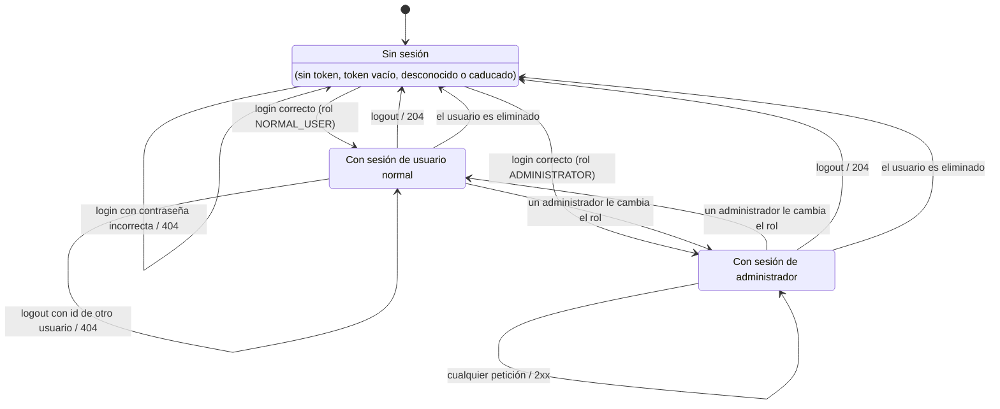

# Diagrama de estados de la sesión

La sesión de un usuario en `pleste-server` se identifica con el token que devuelve `POST /users/login` y que el cliente envía en la cabecera `X-API-KEY`. `AuthorizationManager` decide en cada petición en qué estado está el cliente según ese token y el rol de su usuario.

Cada login crea un token nuevo, así que un mismo usuario puede tener varias sesiones independientes. Cerrar una no afecta a las demás.

## Transiciones y pruebas

Las transiciones se prueban en `SessionStateIT` sobre los endpoints HTTP reales. Las reglas de cada estado se prueban con más detalle en `AuthorizationIT` (integración) y `AuthorizationManagerTest` (unidad).

| Estado de origen | Evento | Estado de destino | Prueba en `SessionStateIT` |
|---|---|---|---|
| Sin sesión | Petición protegida | Sin sesión (401) | `testNoSessionProtectedRequest` |
| Sin sesión | Login con contraseña incorrecta | Sin sesión (404) | `testNoSessionWrongLoginStatus`, `testNoSessionWrongLoginGivesNoToken` |
| Sin sesión (token caducado) | Login correcto | Con sesión | `testLoginWithExpiredToken` |
| Sin sesión | Login correcto de usuario normal | Con sesión normal | `testLoginOpensNormalSession`, `testNormalSessionIsNotAdministrator` |
| Sin sesión | Login correcto de administrador | Con sesión de administrador | `testLoginOpensAdministratorSession` |
| Con sesión normal | Petición no permitida (403) | Con sesión normal | `testForbiddenRequestKeepsSession` |
| Con sesión normal | Cambio de rol a administrador | Con sesión de administrador | `testPromotionWhileLoggedIn` |
| Con sesión de administrador | Cambio de rol a usuario normal | Con sesión normal | `testDemotionWhileLoggedIn` |
| Con sesión | Logout | Sin sesión | `testLogoutStatus`, `testLogoutClosesSession`, `testAdministratorLogoutClosesSession` |
| Sin sesión (tras logout) | Logout con el mismo token | Sin sesión (401) | `testLogoutTwice` |
| Con sesión | Logout con el id de otro usuario | Con sesión (404) | `testLogoutWithAnotherUserId`, `testLogoutWithAnotherUserIdKeepsSession` |
| Con sesión | Otra sesión del mismo usuario hace logout | Con sesión | `testTwoIndependentSessions` |
| Con sesión | El usuario es eliminado | Sin sesión (401) | `testDeletedUserLosesSession` |
